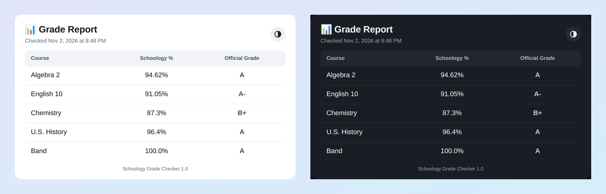

# Schoology Grade Checker

**Your Schoology grades, one click away.** A small desktop app for Windows and Mac that signs in to Schoology for you, reads every class at the same time, and shows your grades in a clean report window.

[](https://github.com/lukehilt11-cpu/SchoologyGrades/releases/latest)




**Website:** <https://lukehilt11-cpu.github.io/SchoologyGrades/>

---

## Download

| Your computer | Download | Notes |
| --- | --- | --- |
| **Windows 10 or 11** | [**SchoologyGrades-Setup.exe**](https://github.com/lukehilt11-cpu/SchoologyGrades/releases/latest/download/SchoologyGrades-Setup.exe) | The installer. No administrator rights needed. |
| **Mac with Apple Silicon** (M1 or newer) | [**SchoologyGrades.dmg**](https://github.com/lukehilt11-cpu/SchoologyGrades/releases/latest/download/SchoologyGrades.dmg) | Open it and drag both apps onto **Applications**. |
| Windows, without installing | [SchoologyGrades-portable.zip](https://github.com/lukehilt11-cpu/SchoologyGrades/releases/latest/download/SchoologyGrades-portable.zip) | Two programs you can run from any folder. |

You need **Google Chrome** installed; that's how the program signs in for you. Python is **not** needed. These links always point at the newest version. All versions are on the [Releases page](https://github.com/lukehilt11-cpu/SchoologyGrades/releases).

### The first time you open it

The programs aren't signed with a paid certificate, so both systems are cautious the first time:

- **Windows:** if it says it "protected your PC", click **More info**, then **Run anyway**.
- **macOS:** the first launch is blocked. Click **Done**, then open **System Settings → Privacy & Security**, scroll down, and click **Open Anyway** next to the app's name. Do this for both **Schoology Setup** and **Schoology Grades**. (Apple removed the old right-click → Open shortcut in macOS Sequoia.) Drag both apps into **Applications** *before* opening them.

Not sure whether your Mac is Apple Silicon? Apple menu → **About This Mac**. If it says *Chip: Apple M1* (or M2, M3…), you're set. Intel Macs aren't supported yet.

## How it works

1. **Install it.** Run the installer. When it finishes, Setup opens.
2. **Choose your classes.** Sign in once in Setup. It finds the classes on your Schoology dashboard, and you tick the ones you want.
3. **Check your grades.** Open **Schoology Grades** whenever you like. A small report window shows every class, usually in under ten seconds.

To change classes later, open **Schoology Setup** again.

## Features

- **Every class at once.** Classes load side by side in parallel browser tabs, so checking six classes takes only a little longer than checking one. When the grades can be read straight from each course page, it skips the page drawing altogether; that shortcut is verified against the real pages first and switches itself off if anything doesn't match.
- **Light, dark, or automatic.** The report follows your computer's theme, and the sun/moon button in its corner lets you pick. Your choice is remembered.
- **It finds your classes.** No copying links: Setup lists the classes on your dashboard and you click the ones you want.
- **Problems in plain words.** Errors say what happened and what to click ("Can't reach the internet", "The sign-in didn't work", "Google Chrome isn't installed"), with Try again / Open Setup buttons. Technical details are kept in a log.
- **Exact percent, familiar letters.** The percent is shown as Schoology gives it (to the hundredth); the letter grade is worked out from the rounded percent using a standard scale.
- **Update notice.** If a newer version has been published, a banner at the top of the report links to it.
- **Stays on your computer.** There's no account and no server of ours.

## Privacy and security

- The program signs in the way you would: in a hidden Chrome window on your own computer.
- Your **email and password are saved as plain text** in `data/config.json`, in the program's `data` folder. Use it only on a computer you trust, and don't share that folder. The saved Chrome sign-in lives next to it.
- It connects to your school's Schoology site and sign-in page; to github.com to check for a newer version; and, the first time and after Chrome updates, to Google to download the small helper that lets the program control Chrome. There are no analytics.
- It is **unofficial**: not made by, or connected to, Schoology, PowerSchool or any school. Your school's own gradebook is the official record, and the letter grades shown here are estimates.
- Check your school's rules on automated tools before using it.
- **To remove everything:** uninstall the program and delete its `data` folder.

## Troubleshooting

| Problem | What to do |
| --- | --- |
| My school wants me to approve the sign-in on my phone | In Setup, tick **Show the browser while signing in** and approve it once. |
| "Chrome couldn't start" | Click **Try again**. If it keeps happening, restart your computer. If the folder is synced by OneDrive, pause syncing or move the folder. |
| macOS can't find my settings | Drag both apps into **Applications** and open them from there, not from Downloads or the disk image. |
| The grades differ from my school's gradebook | The program shows what Schoology shows right now, and the letter is an estimate. Your school's gradebook is official. |
| I changed classes | Open **Schoology Setup** again and tick the new ones. |
| Where are my files? | Installed on Windows: `%LOCALAPPDATA%\Programs\SchoologyGrades\data`. Portable or from source: a `data` folder next to the programs. Apps in the Mac **Applications** folder: `~/Library/Application Support/SchoologyGrades`. |
| Uninstalling | **Windows:** Settings → Apps → Schoology Grade Checker → Uninstall (it asks whether to keep your settings). **Mac:** drag both apps to the Trash. |

---

## For developers

### What's in this repository

```
.
├── .github/workflows/build.yml   Builds the installer and disk image, and publishes a release
├── docs/preview.png              The picture above
├── index.html                    The website (GitHub Pages)
├── README.md
└── source/
    ├── grades.pyw                The grade checker (windowed app)
    ├── setup.py                  Setup: sign in, find classes, choose them
    ├── sgcommon.py               Shared code: browser start-up, sign-in, errors, update check
    ├── grades.spec               PyInstaller recipe for both programs
    ├── installer.iss             Inno Setup script (Windows installer)
    ├── dmg_settings.py           Layout of the Mac disk image (used by dmgbuild)
    ├── make_icons.py             Draws every icon and installer picture into icons/
    ├── build.bat / build.sh      Local builds for Windows / macOS
    ├── VERSION                   The version number, read by everything
    └── icons/                    Drawn by make_icons.py (the build draws any that are missing)
```

A local build also creates `SchoologyGrades.exe` / `SchoologySetup.exe` (or the two `.app` files) next to `source/`, a `releases/` folder, and a `data/` folder when you run them. None of those belong in the repository.

### Run from source

Python 3.10 or newer, and Google Chrome.

```bash
pip install "selenium>=4.6"
python source/setup.py        # choose your classes
python source/grades.pyw      # check your grades (pythonw on Windows avoids a console window)
```

When run this way, the `data` folder is created next to `source/`.

### Build locally

Run these from inside `source/`. The build tools (PyInstaller, Pillow, NumPy, and on a Mac, dmgbuild) are installed automatically the first time, and build output is kept quiet; the full log is saved in a hidden cache folder and shown only if something fails.

| Windows | macOS | What it does |
| --- | --- | --- |
| `build.bat` | `bash build.sh` | Builds the two programs next to `source/` **and** the installer / disk image in `releases/`. |
| `build.bat dev` | `bash build.sh dev` | The two programs only; skips the installer / disk image. |
| `build.bat force` | `bash build.sh force` | Rebuilds even if nothing changed. |
| `build.bat run` | `bash build.sh run` | When done, opens the installer / disk image (with `dev`, the program) to try it. |

The Windows installer needs [Inno Setup 6](https://jrsoftware.org/isinfo.php) (`winget install JRSoftware.InnoSetup`); without it, a portable `.zip` is made instead.

### Publish a release (no Git needed)

1. Upload the changed files to `source/` on GitHub (Add file → Upload files).
2. Edit `source/VERSION` on the website (the pencil icon) and raise the number.
3. That starts **Build and release** under the **Actions** tab. When it finishes, the installer, the Mac disk image and the portable zip appear on the Releases page under fixed names, so the download links above always give the newest version.

You can also start a build by hand: **Actions → Build and release → Run workflow**. The workflow writes a small `REPO` file into the build, which is what switches on the in-app "newer version available" notice. Local builds don't have it, so they never show the notice.

## License

No license has been chosen yet, so all rights are reserved by the author.
